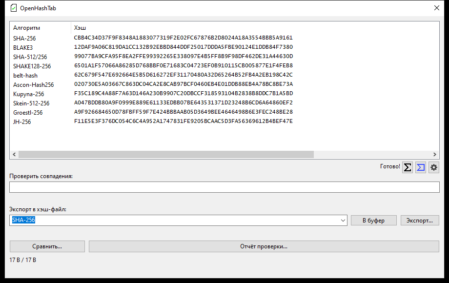
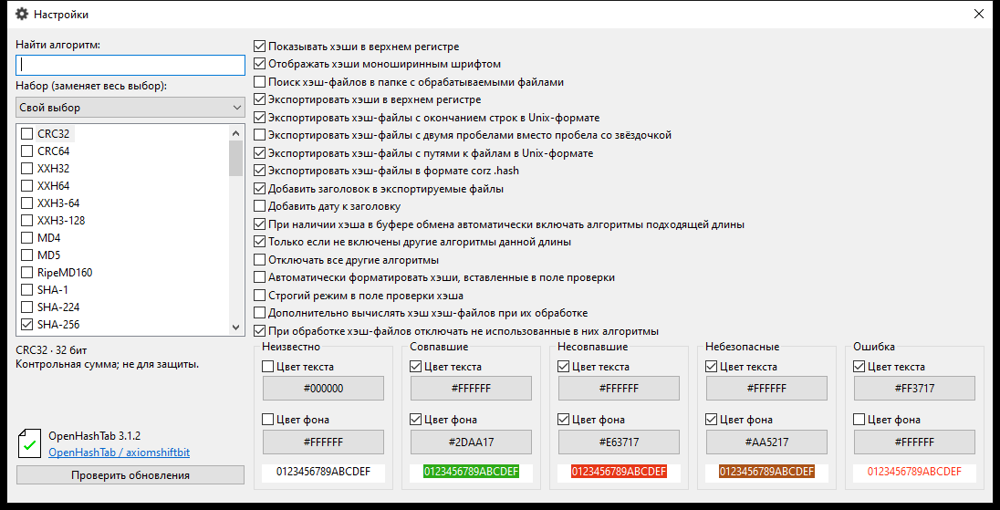
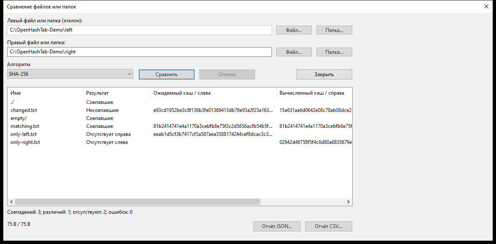

# OpenHashTab

**Русский** · [English](README.en.md)

Вычисление и сверка хешей в Проводнике Windows, отдельном окне и скриптах. Сравнение файлов и папок, экспорт отчётов проверки.

[Скачать](https://github.com/axiomshiftbit/OpenHashTab/releases) · [Сборка и тесты](https://github.com/axiomshiftbit/OpenHashTab/actions/workflows/ci.yml) · [GPL-3.0-or-later](COPYING)

## Установка и работа

Для установки скачайте один файл **`.msi`**, выбрав архитектуру Windows и установку для себя или всех пользователей. **x64** — для 64-битной Windows на процессорах Intel/AMD; **ARM64** — для Windows on Arm. **Machine** устанавливает программу для всех пользователей и требует прав администратора; **User** — только для текущей учётной записи, без прав администратора.

| Файл релиза | Содержимое и назначение |
| --- | --- |
| `OpenHashTab-3.1.2-source.tar.gz` | Исходный код версии **3.1.2**, включая закреплённые версии подмодулей, в архиве tar со сжатием gzip. Нужен для самостоятельной сборки или изучения кода; для установки не требуется. |
| `OpenHashTab-3.1.2-Windows11-candidate.zip` | ZIP-архив со всеми четырьмя MSI ниже, документацией, лицензиями, сведениями о сборке и контрольными суммами SHA-256. **Windows11** обозначает целевую ОС; **candidate** — предварительную сборку, кандидата в релиз. Распакуйте архив и запустите подходящий MSI; это не переносная версия программы. |
| `OpenHashTab_Machine_ARM64.msi` | Установщик для Windows on Arm, **для всех пользователей**; нужны права администратора. |
| `OpenHashTab_Machine_x64.msi` | Установщик для Intel/AMD x64, **для всех пользователей**; нужны права администратора. |
| `OpenHashTab_User_ARM64.msi` | Установщик для Windows on Arm, **только для текущего пользователя**, без прав администратора. |
| `OpenHashTab_User_x64.msi` | Установщик для Intel/AMD x64, **только для текущего пользователя**, без прав администратора. |

**3.1.2** — версия программы. В названиях MSI версия не указана: скачивайте их из нужного релиза. **`.msi`** — пакет установщика Windows Installer. Например, на ПК с Intel/AMD выберите `OpenHashTab_User_x64.msi` для своей учётной записи или `OpenHashTab_Machine_x64.msi` для всех пользователей. Достаточно одного установщика. Предварительные сборки не подписаны; контрольные суммы SHA-256 приложены к загрузкам.

Целевая ОС — Windows 11 x64/ARM64. Локальное тестирование также проводится на Windows 10 Enterprise LTSC; точные версии Windows 11 и результаты указаны в Actions.

1. Нажмите правой кнопкой на файл → **Свойства → Хэши**, либо **Показать дополнительные параметры → Хэши** в Windows 11.
2. Выберите алгоритмы в **Настройках**. Вставьте известную сумму в поле **Проверить совпадения**; двойной щелчок по результату копирует его.
3. Используйте **Сравнить…** для двух файлов/папок, **Отчёт проверки…** для CSV/JSON или обычный экспорт для создания файла контрольных сумм.

## Возможности

- **61 вариант хеширования**, поиск алгоритмов, пояснения и наборы настроек.
- Сравнение файлов/папок: совпадения, различия, отсутствующие элементы, пустые каталоги и ошибки чтения.
- Отчёты CSV/JSON: путь, алгоритм, ожидаемый и вычисленный хеш, результат и ошибка.
- Прогресс: обработанный объём, средняя скорость, оставшееся время и отмена.
- Проверка файлов контрольных сумм, экспорт и буфер обмена; Unicode и длинные пути.
- Проверка через VirusTotal по желанию пользователя и командная строка.

Старые алгоритмы сохранены для совместимости. Набор **«Рекомендуемые»** выбирает SHA-256 и BLAKE3; CRC/xxHash и старые MD4/MD5/SHA-1 не заменяют современные криптографические хеши.

[Параметры и источники алгоритмов](Algorithms/extended/README.md) · [Эталонные тесты](tests/ExtendedHashVectors.md)

**При обновлении:** пересчитайте суммы ParallelHash для непустых файлов, полученные исходной версией: в ней была ошибка передачи длины в байтах вместо битов.

## Поддерживаемые хеши

Полный список содержит **61 вариант**. Названия приведены как в программе; разные длины результата учитываются как отдельные варианты.

| Семейство | Поддерживаемые варианты |
| --- | --- |
| CRC | `CRC32`, `CRC64` |
| xxHash | `XXH32`, `XXH64`, `XXH3-64`, `XXH3-128` |
| MD | `MD4`, `MD5` |
| RIPEMD | `RipeMD160` |
| SHA-1 | `SHA-1` |
| SHA-2 | `SHA-224`, `SHA-256`, `SHA-384`, `SHA-512`, `SHA-512/224`, `SHA-512/256` |
| SHA-3 | `SHA3-224`, `SHA3-256`, `SHA3-384`, `SHA3-512` |
| SHAKE | `SHAKE128-256`, `SHAKE256-512` |
| BLAKE2 | `Blake2sp`, `BLAKE2b-256`, `BLAKE2b-512`, `BLAKE2s-256` |
| BLAKE3 | `BLAKE3`, `BLAKE3-512` |
| KangarooTwelve | `K12-264`, `K12-256`, `K12-512` |
| ParallelHash | `PH128-264`, `PH256-528` |
| Стрибог (ГОСТ Р 34.11-2012) | `GOST 2012 (256)`, `GOST 2012 (512)` |
| BelT | `belt-hash` |
| eDonkey | `eD2k`, `eD2k (Old)` |
| QuickXorHash | `QuickXorHash` |
| Ascon | `Ascon-Hash256`, `Ascon-XOF128-256`, `Ascon-CXOF128-256` |
| TurboSHAKE | `TurboSHAKE128-256`, `TurboSHAKE256-512` |
| KT256 | `KT256-512` |
| Купина (Kupyna) | `Kupyna-256`, `Kupyna-384`, `Kupyna-512` |
| Skein | `Skein-256-256`, `Skein-512-256`, `Skein-512-512`, `Skein-1024-1024` |
| Grøstl | `Groestl-224`, `Groestl-256`, `Groestl-384`, `Groestl-512` |
| JH | `JH-224`, `JH-256`, `JH-384`, `JH-512` |
| Whirlpool | `Whirlpool` |

## Командная строка

Пример для установки Machine:

```powershell
$cli = 'C:\Program Files\OpenHashTab\OpenHashTabCLI.exe'
& $cli hash 'C:\Data\file.iso'
& $cli verify --algorithm SHA-256 'C:\Data\checks.sha256'
& $cli compare --format json 'C:\Data\before' 'C:\Data\after'
& $cli algorithms
```

Коды возврата: **0** — успех, **1** — различия, **2** — неверные аргументы, **3** — ошибка чтения/операции/вывода, **4** — отмена. [Подробное руководство, форматы и ограничения](docs/Usage.md).

## Скриншоты

Реальная версия 3.1.2 на тестовой машине с демонстрационными файлами.



<details>
<summary>Настройки и сравнение папок</summary>





</details>

## Приватность и проверки

Хеши вычисляются локально. После согласия VirusTotal получает хеш, путь и дату создания файла; содержимое файла не загружается. Проверка обновлений обращается к GitHub по отдельному действию пользователя. Администратор может отключить VirusTotal ненулевым DWORD `ForceDisableVT` в `HKLM\SOFTWARE\OpenHashTab` (в обоих представлениях реестра при использовании x86 и x64). DWORD `LangIdOverride` в `HKCU\SOFTWARE\OpenHashTab` задаёт язык интерфейса: `1049` — русский, `1033` — английский.

CI включает эталонные и потоковые тесты, сборки x86/x64/ARM64, установку/обновление/восстановление/удаление в Windows 11, CodeQL, OSV/NVD, ASan/UBSan, Defender и Sysmon. Это не криптографическая сертификация; архив Skein не имеет идентификатора пакета OSV. Сравнение папок не создаёт снимок ФС и не сравнивает ACL и альтернативные потоки данных.

## Сборка

Windows; Visual Studio 2022 C++, Clang, CMake, Ninja, Python 3, .NET SDK, Windows SDK/WDK 10.0.26100.0 и PowerShell 7.3+:

```powershell
git submodule update --init --recursive
pwsh ./build_all.ps1 -Compiler MSVC
```

## Авторство и лицензия

Основано на **[OpenHashTab](https://github.com/namazso/OpenHashTab)** автора **[namazso](https://github.com/namazso)**. Независимо поддерживаемый репозиторий создан из ветки `master` проекта [MarkDDi/OpenHashTab](https://github.com/MarkDDi/OpenHashTab) с сохранением истории. Это не означает одобрения доработок оригинальным автором.

Авторские права 2019–2025 namazso и соответствующих участников. [GNU GPL v3 или более поздняя](COPYING); уведомления сторонних компонентов сохранены в исходниках и пакетах. См. [уведомления установщика](Setup/InstallerLicense.rtf), [лицензию Bee2](Algorithms/bee2/bee2/LICENSE.txt), [дополнительные реализации](Algorithms/extended/README.md).
