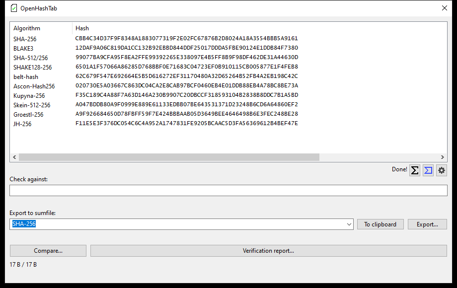
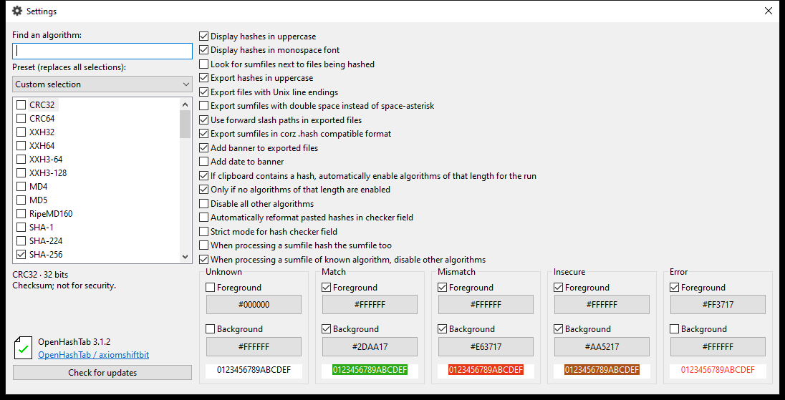
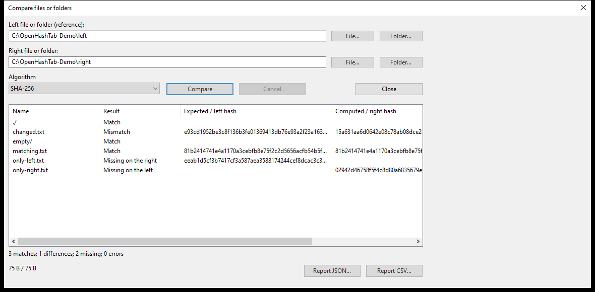

# OpenHashTab

**English** · [Русский](README.ru.md)

Calculate and verify file hashes in Windows Explorer, a standalone window, or scripts. Compare files and folders and export verification reports.

[Download](https://github.com/axiomshiftbit/OpenHashTab/releases) · [Build and tests](https://github.com/axiomshiftbit/OpenHashTab/actions/workflows/ci.yml) · [GPL-3.0-or-later](COPYING)

## Install and use

Choose **x64** for Intel/AMD or **ARM64** for Windows on Arm. **Machine** installs for all users; **User** installs for your account. Release candidates are unsigned; SHA-256 checksums accompany the downloads.

Target: Windows 11 x64/ARM64. Testing also includes Windows 10 Enterprise LTSC on the local test machine; see Actions for the exact Windows 11 versions and results.

1. Right-click a file → **Properties → Hashes**, or **Show more options → Hashes** in Windows 11.
2. Choose algorithms in **Settings**. Paste a known hash into **Check against**; double-click a result to copy it.
3. Use **Compare…** for two files/folders, **Verification report…** for CSV/JSON, or the regular export controls to create a checksum file.

## Features

- **61 hash variants**, algorithm search, descriptions and selection presets.
- File/folder comparison: matches, differences, missing entries, empty directories and read errors.
- CSV/JSON reports: path, algorithm, expected and actual hash, status and error.
- Progress with processed bytes, average speed, estimated time remaining and cancellation.
- Checksum-file verification, export and clipboard; Unicode and long paths.
- Optional VirusTotal lookup and a command-line interface.

Families include SHA-2/SHA-512/t, SHA-3/SHAKE, BLAKE2/BLAKE3, Streebog, BelT, Kupyna, Ascon, TurboSHAKE/KT256, Skein, Grøstl, JH and Whirlpool. Legacy checksums remain available for compatibility. The **Recommended** preset selects SHA-256 and BLAKE3; CRC/xxHash and legacy MD4/MD5/SHA-1 are not substitutes for modern cryptographic hashes.

[Algorithm parameters and sources](Algorithms/extended/README.md) · [Reference test vectors](tests/ExtendedHashVectors.md)

**Upgrading:** recalculate ParallelHash checksums for nonempty files produced by the original version: its byte/bit length handling was incorrect.

## Command line

Example for a Machine installation:

```powershell
$cli = 'C:\Program Files\OpenHashTab\OpenHashTabCLI.exe'
& $cli hash 'C:\Data\file.iso'
& $cli verify --algorithm SHA-256 'C:\Data\checks.sha256'
& $cli compare --format json 'C:\Data\before' 'C:\Data\after'
& $cli algorithms
```

Exit codes: **0** success, **1** differences, **2** invalid arguments, **3** read/operation/output error, **4** cancelled. [Detailed guide, formats and limitations (Russian)](docs/Usage.md).

## Screenshots

Actual version 3.1.2 on the test machine, using demonstration files.



<details>
<summary>Settings and folder comparison</summary>





</details>

## Privacy and testing

Hash calculation is local. After consent, VirusTotal receives the hash, file path and creation date; file contents are not uploaded. Update checks contact GitHub on request. Administrators can disable VirusTotal with a nonzero `ForceDisableVT` DWORD under `HKLM\SOFTWARE\OpenHashTab` (both registry views if using x86 and x64 components). `LangIdOverride` under `HKCU\SOFTWARE\OpenHashTab` selects the UI language: `1033` English, `1049` Russian.

CI includes known-answer and streaming tests, x86/x64/ARM64 builds, Windows 11 installation/upgrade/repair/uninstall, CodeQL, OSV/NVD, ASan/UBSan, Defender and Sysmon. These checks are not cryptographic certification; the Skein archive has no OSV package identifier. Folder comparison is not a filesystem snapshot and does not compare ACLs or alternate data streams.

## Build

Windows; Visual Studio 2022 C++, Clang, CMake, Ninja, Python 3, .NET SDK, Windows SDK/WDK 10.0.26100.0 and PowerShell 7.3+:

```powershell
git submodule update --init --recursive
pwsh ./build_all.ps1 -Compiler MSVC
```

## Credits and license

Based on **[OpenHashTab](https://github.com/namazso/OpenHashTab)** by **[namazso](https://github.com/namazso)**. This independently maintained repository started from the `master` branch of [MarkDDi/OpenHashTab](https://github.com/MarkDDi/OpenHashTab), preserving its history. It does not imply endorsement by the original author.

Copyright 2019–2025 namazso and the respective contributors. [GNU GPL v3 or later](COPYING); third-party notices remain in the sources and packages. See [installer notices](Setup/InstallerLicense.rtf), [Bee2 license](Algorithms/bee2/bee2/LICENSE.txt), and [additional implementations](Algorithms/extended/README.md).
